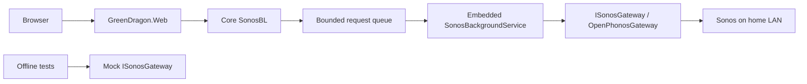

# Architecture

## SUMMARY

The Green Dragon is a single web application with an embedded, request-driven Sonos worker. The portal shows read-only now-playing snapshots; playback controls and shortcuts remain future work.

## Solution profile

| Dimension | Value | Source |
|---|---|---|
| Product / namespace | The Green Dragon / GreenDragon | Explicit project name GreenDragon.Web |
| Application shape | Single web app | Requested |
| API style | ASP.NET Core controllers; health only | Default |
| UI | Razor Pages, VanillaJS and CSS | Requested |
| Storage | None | Requested; no runtime persistence |
| Identity | Anonymous | Inferred home-network portal, no identity store |
| Orchestration | .NET Aspire | Default |
| Admin CLI | None | Requested |
| Background work | Embedded request-driven hosted service; no timers or schedules | Requested |
| Deployment | Host on the home LAN | Inferred: local Sonos UPnP requires network access |
| Tests | Small Core unit suite and Web integration suite, fully mocked Sonos | Requested reduction of default test projects |

## Projects

- GreenDragon.Web: Razor Pages, local static assets, configuration and health controller.
- GreenDragon.Core: business interfaces, rules, command worker and the OpenPhonos adapter.
- GreenDragon.AppHost: local orchestration of the Web host.
- GreenDragon.ServiceDefaults: telemetry, discovery, HTTP resilience and development probes.
- OpenPhonos.UPnP and OpenPhonos.Sonos: .NET 10 source-build wrappers for the pinned, unmodified dependency.
- GreenDragon.Core.UnitTests and GreenDragon.Web.IntegrationTests: lightweight offline checks.

## Execution and boundaries

The singleton hosted worker waits on a bounded channel. A Razor Page POST calls Core business logic, queues discovery and snapshot reads, and waits for its result. When enabled, the browser sends this antiforgery-protected POST once after opening the page, and on manual refresh. Only one request executes at a time. GET, health checks, startup and idle time never cause Sonos network access. Sonos:Enabled is false in checked-in configuration.

OpenPhonos discovery has no CancellationToken overload. The caller can stop waiting and queued canceled work is skipped, but an in-flight upstream operation must finish before another begins. There are no event subscriptions or background renewal tasks in this increment. Upstream discovery updates its listener address but the application does not subscribe to device events.

State is returned to the requesting page only; there is no shared snapshot store or persistence. See [the integration guide](integrations.md) for dependency maintenance.

## Cross-cutting concerns

Configuration uses ASP.NET defaults with an optional local JSON file inserted before user secrets, environment variables and command-line overrides. Optional Key Vault configuration is last. Structured logs use Serilog console output and Aspire OpenTelemetry; Application Insights is enabled only with a connection string.

Razor Pages enforce antiforgery for POST. Razor encodes all device metadata. Security headers, HTTPS redirection and production HSTS protect browser traffic. Access is anonymous and must stay confined to the trusted home network. See [environment](environment.md).

Aspire runs the portal; there is no storage, migration runner, CLI, scheduler, or Azure deployment model.
